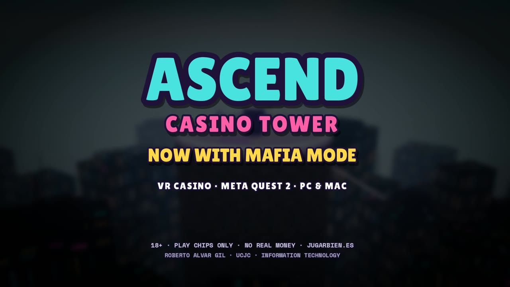
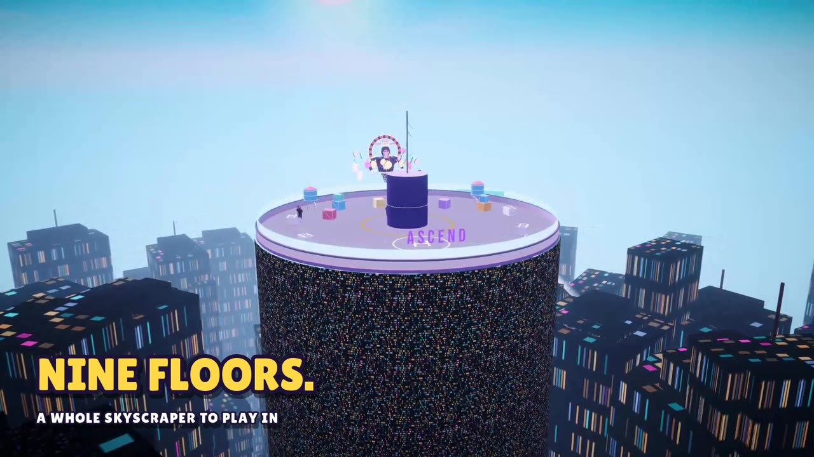
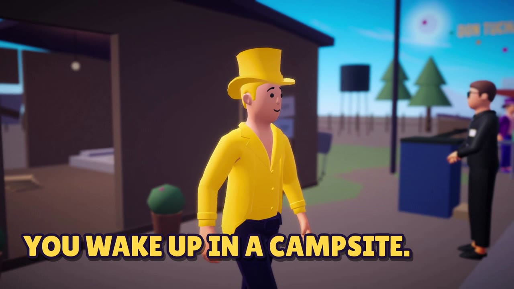
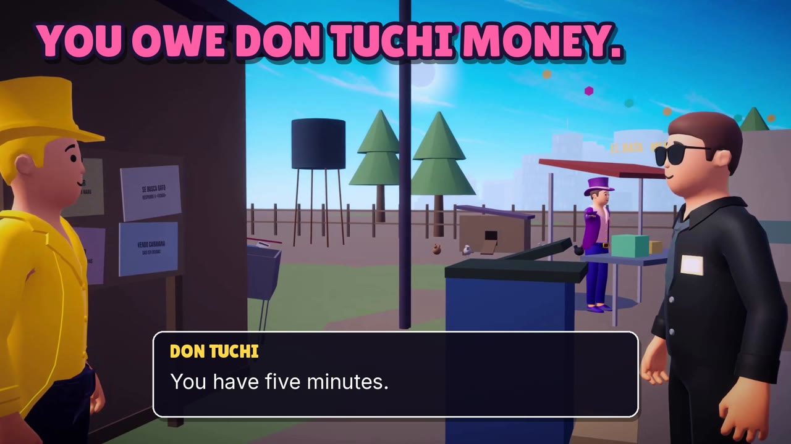
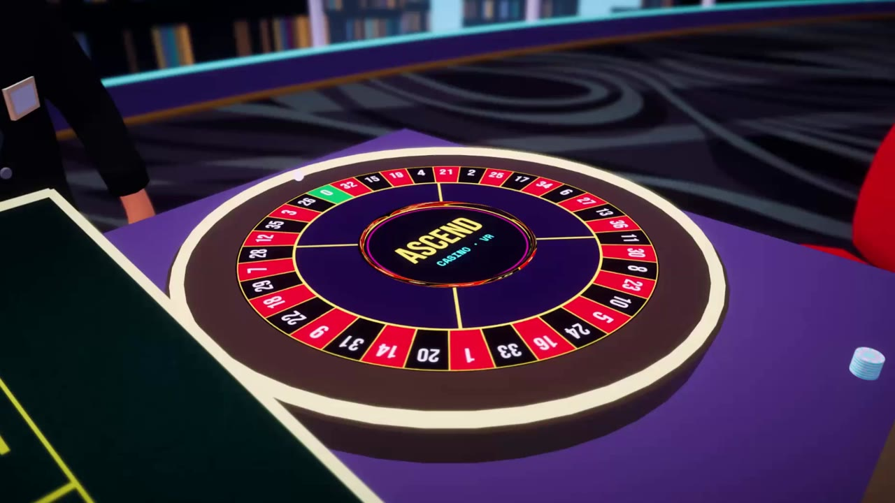
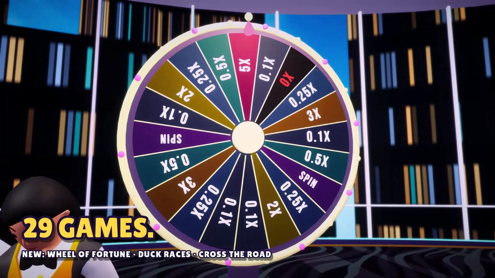
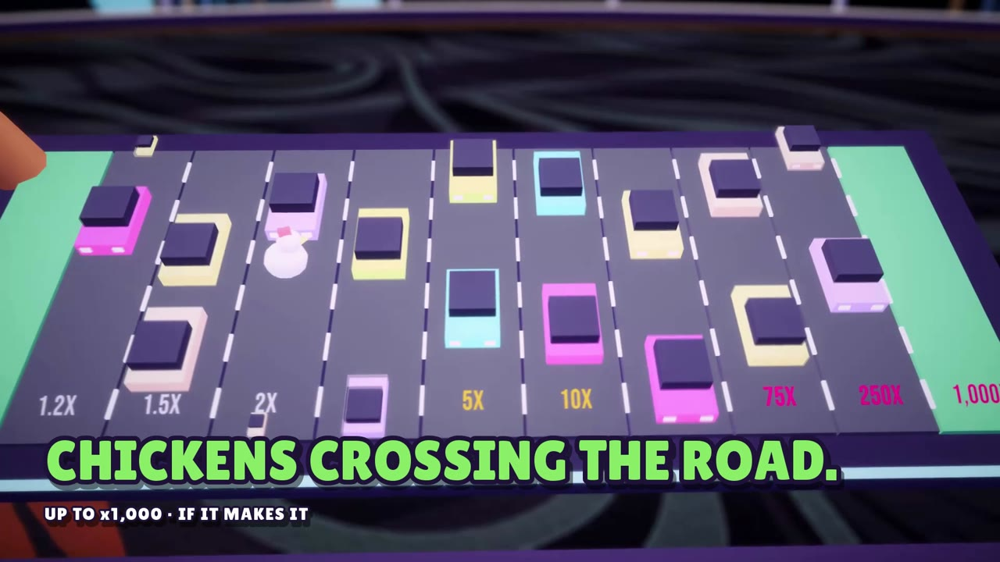

<div align="center">



# ASCEND · Casino Tower

**A virtual-reality casino you climb, floor by floor, to pay off a debt to the mafia.**

Unity 6 · Meta Quest 2 · Windows · macOS · Web browser

**[▶ Play in your browser](https://claude.ai/artifact/4EiKgrJSGRSggiZ3Z8jyvv)** · **[The Making of ASCEND (interactive site)](https://tinyurl.com/AscendCasino)**

`18+` · `play chips only` · `no real money` · `no pay-to-win`

</div>

---

## What is ASCEND?

ASCEND is a VR game set inside a nine-floor glass skyscraper that is one giant casino. It was built as the team project for the **Information Technology** course at **UCJC (Universidad Camilo José de Cela, Madrid)** and presented in class on **23 November 2026** in the course's *Metaverse presentation*.

Most casino games are a menu of tables. ASCEND is a **place**: you walk up to the table, sit down, talk to the people around you and take the lift to the next floor. Underneath it there is a story and a reason to keep playing.

**The story (mafia mode).** You wake up in a run-down campsite owing money to **Don Tuchi**, a mafia boss. You have **15 days** to pay him back. Every morning his driver takes you to the tower, and every day you have **five minutes** inside the casino to earn that day's quota, which grows each day. Miss it once and the mafia takes you somewhere quiet and you start again from day 1. On day 15 there is no quota: you have to beat the final boss, **THE HOUSE**, on the rooftop. The motto says it all: *the house always wins.*

**The ethics are part of the design.** ASCEND is a game that uses the casino as its setting and as its joke, not a gambling product:

- Everything is played with fictional chips. There is no real money anywhere and nothing to buy.
- The rules of every game state exactly how much each bet pays. There are no fake near-misses, and losses are never celebrated as wins.
- Rewards give chips and XP, never better odds.
- Responsible-play tools are built in: an optional loss limit, a reality check, a pause button and a link to [jugarbien.es](https://www.jugarbien.es).

<table>
<tr>
<td></td>
<td></td>
<td></td>
</tr>
<tr>
<td></td>
<td></td>
<td></td>
</tr>
</table>

---

## The team

ASCEND was made by four UCJC students. Each of us owned one part of the project and presented it.

| | Who | What they did |
|---|---|---|
| 🎲 | **Roberto Alvar Gil** ([@choperman07](https://github.com/choperman07)) | **Development lead.** Built the game in Unity: the code, the procedural world builder, the 29 games, the builds for Quest, Windows, Mac and the web, the trailer recorded inside the game, the making-of video and the interactive website. Put together the final presentation. |
| 📖 | **Stephan Gotze** | **Concept and story.** The idea of a casino you climb, the mafia-debt narrative, who the game is for and how we pitched it. Opened and closed the presentation. |
| 🏛️ | **Paul Mauricio** | **Art direction and world.** The visual identity (palette, type, the contrast between the shining tower and the dusty campsite), the design of the building and its floors, the team's hidden HQ and the Ronin collection. |
| 🕹️ | **Alejandro Caballero** ([@alecabg](https://github.com/alecabg)) | **Gameplay.** The core loop (home → mafia car → casino → quota), progression through the floors, rewards and black-market modifiers, and the live demo. |

The code was written with the help of an AI assistant (Claude, by Anthropic), directed, reviewed and tested floor by floor by the team inside Unity.

---

## Features

### Nine floors, 29 games

| Floor | Name | What's there | Mafia mode: opens on day |
|---|---|---|---|
| 1 | **Lobby** | DJ stage and LED dance floor, The High Bar, slots, The Vault, the cashier, Avatar Studio | 1 |
| 2 | **The Classics** | 17 tables: European roulette, blackjack 6:5, baccarat, high-limit tables | 1 |
| 3 | **The Card Room** | Dragon Tiger, Casino Hold'em, Three Card Poker, Video Poker, Texas Hold'em against 4 bots | 3 |
| 4 | **Dice & Wheels** | Money Wheel, Sic Bo, Keno, Craps, roulette | 5 |
| 5 | **Fast Rounds** | Crash, Mines, Plinko, Dice, Limbo, Hi-Lo, Tower | 7 |
| 6 | **Luck & Loot** | 26 slot machines, Catch a Fish, Coinflip, Mystery Box, Crate Vault | 9 |
| 7 | **Derby & Battles** | Horse racing, Case Battles, Crash, Coinflip, leaderboard | 11 |
| 8 | **Sky Lounge** | 9 VIP tables, Sky Bar, VIP lounges, the golden chip | 13 |
| 9 | **Rooftop · Raid** | A shooter boss fight against **THE HOUSE** | 15 (final day) |
| −1 | **The Basement** | The team's hidden HQ, reached through the shady guy in the lift | after his errands |

Latest additions, shown in the trailer: **Wheel of Fortune**, **Duck Races** and **Cross the Road**.

### Mafia mode
- A 15-day run with a daily quota that grows every day and a five-minute clock per day.
- **Black market**: four offers a day, paid with your chips. Rusty Clover, Lucky Glasses, Loaded Dice, Cheap Lawyer, Cousin's Loan, Energy Drink, Stolen Watch and more.
- Floors unlock as the days go by. The last day is the rooftop raid, followed by a final **double or nothing** coin flip.

### A living casino
- Croupiers deal, waiters carry trays, security watches the door, and guests play, cheer, drink and dance.
- You can talk to anyone, invite them for a drink, or meet the shady guy in the lift.
- Ranks, XP, daily missions, a free crate every 25 rounds and a Ronin collection with five rarities.

### Made for VR, playable anywhere
- **Meta Quest 2** with OpenXR and the XR Interaction Toolkit: hands with fingers driven by the controllers, sitting at tables, wrist menus and a lift that actually moves.
- **Windows and Mac** with keyboard and mouse.
- **Web browser** (WebGL), with nothing to install.
- **Online** with Netcode for GameObjects, Unity Multiplayer Services and Vivox proximity voice chat.

---

## How it is built

The key technical decision is that **the world is not placed by hand in the editor: code generates it.** One editor script, `AscendWorldBuilder`, run from the menu **ASCEND → Build World**, does four things:

- repairs the project settings;
- loads the art pack;
- raises the nine floors with their tables, builds the city around them and creates the VR rig;
- bakes the reflections.

Any change applies to the whole tower at once, and the project can be rebuilt from zero on any machine.

A second idea makes the casino scale: **one shared engine runs every table**. Seats, chips, bets and payouts live in a common `TableGame` base, so a new game takes minutes, not weeks.

| | |
|---|---|
| Engine | Unity 6 (6000.0.84f1), Universal Render Pipeline |
| Code | **143 C# scripts · ~29,600 lines** |
| VR | OpenXR, Meta Quest support, XR Interaction Toolkit 3, XR Hands |
| Online | Netcode for GameObjects, Unity Multiplayer Services, Vivox |
| Tools | Unity, Python + FFmpeg (trailer editing), HTML/JS (websites) |

### Code tour

```
Assets/ASCEND/
├── Editor/                 World builder, asset import, desktop & web builds, trailer recorder
├── Runtime/
│   ├── Core/        (19)   Game state, audio, UI kit, palette, mesh helpers, graphics quality
│   ├── Casino/      (15)   Shared table engine: seats, chips, bet spots, cards, dealers
│   ├── Games/       (33)   The games: Roulette, Blackjack, Baccarat, Poker, Craps, Crash, Mines, Plinko, Slots, Horse Race…
│   ├── World/       (40)   Tower, floors, lift, bots and crowds, security, DJ stage, avatars, intro cinematic
│   ├── Run/         (11)   Mafia mode: run director, the campsite, Don Tuchi, black market, HUD
│   ├── Raid/         (4)   Rooftop boss fight against THE HOUSE
│   ├── Player/      (14)   VR rig, hands, seating, desktop HUD, menus, wrist chat
│   └── Online/       (2)   Network player and session
├── Shaders/                Neon, glow, sky and overlay shaders
└── Scenes/ASCEND_World.unity
```

### The trailer was shot by code
There was no screen recording and no film crew. `TrailerRecorder` and `TrailerDirector` fly the camera through the tower along scripted shots, Unity renders every frame at 60 fps, and a Python script cuts it to the music and adds the captions. Every update can ship with a brand-new trailer at zero cost. Watching those trailers frame by frame also served as visual QA: it caught the bugs we then fixed in the engine.

---

## Getting started

> **Heads-up:** to respect their licences, this repository does **not** include the third-party art packs from the Unity Asset Store or the Mixamo characters. Clone it, then import the free packs listed below before building the world.

1. Install **Unity 6000.0.84f1** (or another Unity 6000.0.x) with Android Build Support if you want the Quest build.
2. Clone this repository and open it with Unity Hub.
3. Import the free packs from the Asset Store (**Package Manager → My Assets**), at least **Casino FREE – Low Poly Asset Pack** by ithappy. See [Third-party assets](#third-party-assets) for the full list.
4. Run **ASCEND → Build World** and wait 1–3 minutes.
5. Press **Play**.

**Desktop controls:** `WASD` to move · `Q`/`E` or mouse to turn · left click to use, sit and talk · `Space` to stand up and skip dialogue · `Tab` for the menu · `1`–`9` to change floor (free mode).

**Quest 2:** run **ASCEND → Configure Project for Quest 2**, switch to Android, enable OpenXR with Meta Quest Support, then **Build And Run**.

---

## Third-party assets

Everything else in ASCEND is original work made for the project: code, procedural meshes, felts, NFT cards, chips, music, voices and sound effects.

| Asset | Author | Licence | In this repo? |
|---|---|---|---|
| Casino FREE – Low Poly Asset Pack | ithappy | Unity Asset Store EULA | No: import it from the Asset Store |
| Other free Asset Store packs (Kevin Iglesias animations, Low Poly Guns, Supercyan characters, Infima Games, Super Furniture, OToon shading…) | various | Unity Asset Store EULA | No: import them from the Asset Store |
| Y-Bot, Michelle, Vanguard, Samba dance | Adobe Mixamo | Mixamo licence | No: download them from mixamo.com |
| KayKit Adventurers, Furniture, Space Base, Restaurant Bits | Kay Lousberg | CC0 1.0 | Yes |
| Robot Expressive | Quaternius | CC0 1.0 | Yes |
| Blaster Kit (weapons, drone, sounds) | Kenney | CC0 1.0 | Yes |
| Sofa, chairs, pouf, lamp, plant, concept car | Wayfair, Darmstadt Graphics Group, Microsoft (Khronos glTF Sample Assets) | CC BY 4.0 / CC0 1.0 | Yes |
| Fonts: Lilita One, Bebas Neue, Inter, Space Mono | Google Fonts | SIL Open Font License | Yes |

Full per-file credits are in [`Assets/ASCEND/Imported/CREDITS.md`](Assets/ASCEND/Imported/CREDITS.md).

---

## Links

- **[Play ASCEND in your browser](https://claude.ai/artifact/4EiKgrJSGRSggiZ3Z8jyvv)**. Best in Chrome or Edge on a computer, about a 216 MB download.
- **[The Making of ASCEND](https://tinyurl.com/AscendCasino)**. An interactive map of the 766 pieces of the code, the making-of video and three games you can play on the page.

---

<div align="center">

**ASCEND** · UCJC · Information Technology · 2026<br>
Stephan Gotze · Paul Mauricio · Alejandro Caballero · Roberto Alvar Gil

*18+ · play chips only · no real money · the house always wins.*

</div>
